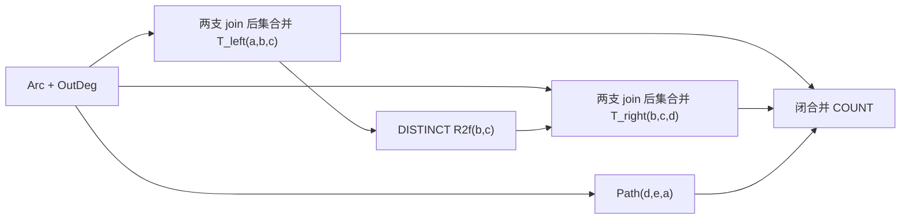

# Hand-selected FlowLog plans → SQL

已将指定目录的 **80 个 `.dl` plans、8 类查询**改写为 DuckDB SQL。上游检出在 `/data/Partitioned-Join-Flowlog`，固定 revision 为 `859f71273504f72e3f4cfd730f1067d725b9ce93`。检出使用 sparse checkout，包含 hand-selected plans、planlib、baseline 和 datalog。

改写入口是 [translate.py](translate.py)，默认使用 [cte.py](cte.py) 生成与原项目一致的 **有序 WITH closure**。可运行文件在 [cte_plans/](cte_plans/)，逐文件 source/SQL hash、物化选择、join operators 和分支互斥证明在 [manifest.json](cte_plans/manifest.json)。先前逐 predicate CTAS 的 [plans/](plans/) 保留为正确性与性能对照。本次改写独立于原有 split compiler 和 cardinality optimizer。

| Query family | 原始图模式 | Plans |
|---|---|---:|
| `5cycle` | 五环 | 4 |
| `5cycle_1` | 五环 + ac | 7 |
| `5cycle_2` | 五环 + ac, bd | 23 |
| `5cycle_3` | 五环 + ac, ce | 7 |
| `5cycle_4` | 五环 + ac, bd, ce | 11 |
| `5cycle_5` | 五环 + ac, bd, ce, da | 11 |
| `5clique` | 五环 + ac, bd, ce, da, eb | 9 |
| `5starfish` | 五环 abcde + 所有外圈点到 f 的边 | 8 |

查询按 directed relation 的完整赋值计数；允许不同变量取相同值，不额外施加 injective embedding 或顶点排序。

## 这些 rules 做了什么

上游 [planlib/datalog.py](https://github.com/DreamingHwz/Partitioned-Join-Flowlog/blob/859f71273504f72e3f4cfd730f1067d725b9ce93/robustness/planlib/datalog.py) 和实际 rule bodies 使用以下操作：

| Rule 结构 | 含义 | SQL |
|---|---|---|
| `OutDeg(x,count:{Arc(x,y)})` | 原始边集的出度 | 按 source `GROUP BY` |
| `InDeg(y,count:{Arc(x,y)})` | 原始边集的入度 | 按 destination `GROUP BY` |
| `Arc_..._L/H` 或 `RL_oo/RH_oo` | 根据指定 degree 比较过滤边 | degree tables 的 `JOIN` + 原样保留 `< / <= / >` |
| `..._by_...` | 某个 split case 中的 join，可能继续吸收其他约束 | 独立命名的有序 join；是否物化取决于复用 |
| `..._join` | 普通 prejoin，可与其他子查询共享原始 atom | 有序 join；单次使用时 inline |
| `R2f(b,c) :- T(_,b,c)` | 保留参与 T 的边，用作后续过滤 | `SELECT DISTINCT b,c FROM T` |
| 同一 predicate 的多个 rules | 该关系是这些结果的集合并 | 证明输出互斥时 `UNION ALL`，否则 `UNION` |
| 同一 predicate 在另一组变量上被调用 | 复用同一个关系，并按位置重新绑定列 | 同一 CTE 的不同 alias/column mapping |

这里的 degree 是固定在原始 `Arc` 上计算的 **proxy**。有的后续 split 已经面对一个 triangle 或更大的中间关系，依然读 `OutDeg/InDeg`，没有重新统计候选中间表的真实扩展度。因此，不能直接把我们此前基于真实 `min(d_S,d_T)` 的扩展 bound 套在这些 proxy decisions 上。

`<=` 和 `<` 的边界原样保留，tie 不能两边都收。degree key 不存在时，原 rules 的正关系匹配失败；SQL 同样使用 inner join，不擅自补零。

上游会共享同构的完整 rule definitions，并在调用处置换列。改写器读取实际 bodies，不从中间表名字猜测内容；每个已有 predicate 保留自己的 producer，没有新增跨 predicate 的合并。

## 一个完整例子：`5cycle_2/9rr`

原查询是：

```datalog
Q(a,b,c,d,e) :- Arc(a,b), Arc(b,c), Arc(c,d),
                Arc(d,e), Arc(e,a), Arc(a,c), Arc(b,d).
```

这个 plan 先在 `(a,b)` 上比较 `OutDeg(b)` 和 `OutDeg(a)`，两支分别先扩展 `bc` 或 `ac`，再闭合另一条边，得到 triangle `T_left(a,b,c)`。然后投影出 `R2f(b,c)`，把它作为第二个 triangle `T_right(b,c,d)` 的过滤条件。第二个 triangle 也按两个端点的出度选择扩展顺序，最后通过 `d→e→a` 闭合。



例如投影部分必须写成：

```sql
R2f AS MATERIALIZED (
  SELECT DISTINCT b,c FROM T_left
)
```

不同的 `a` 可以给出同一个 `(b,c)`。直接 `SELECT b,c` 再普通 join 会把多个 witness 当作 multiplicity，改变结果。也可用保持等价的 semijoin 表达过滤。

当前推荐版本在 [cte_plans/5cycle_2/9rr.sql](cte_plans/5cycle_2/9rr.sql)：`Arc`、`OutDeg`、公共 tagged routing、共享的左 triangle 和 `R2f` 物化，右 triangle 和路径 inline，最终 join 直接送入 COUNT。公共 base-edge partition 的所有调用仍保留 `tag=0/1`；两个子问题各自生成的 producer 保持独立。先前的可读临时表示例保留在 [examples/5cycle_2_9rr.sql](examples/5cycle_2_9rr.sql)，逐 predicate CTAS 对照在 [plans/5cycle_2/9rr.sql](plans/5cycle_2/9rr.sql)。

**`9r.dl` 与 `9rr.dl` 实际不同：** `9r` 的 plan 注释也写了 projection，但 rule bodies 没有 `R2f`；它直接计算第二个 triangle。`9rr` 才真正包含 projection/filter。因此翻译依据 bodies，不能只照注释重建计划。

## 为什么比目前的搜索空间更宽

这些 plans 可以写成 SQL，但当前 cardinality search 不能直接枚举到全部：

- 有多层 split，split 可以出现在 join 之后；当前搜索限制为一次 split。
- 允许重叠 prejoin，例如 `5cycle_1/b1` 同时构造 `ab,bc,ac` 与 `cd,de,ea,ac`，两者共享 `ac`。这超出了“互不重叠的 atom groups”的搜索限制。
- 允许 projection/semijoin reduction，例如 `9rr` 的 `R2f`。
- 复用对象是带完整生产规则与列映射的关系 DAG，不只是合并后的 atom names。

上游已有的 `planlib/sql.py` backend 当前只接受 Split/Leaf，遇到 Join/Project 会拒绝；它还采用真实候选扩展度，与 `.dl` 的 base-degree proxies 不同。因此这里直接翻译 `.dl` bodies，覆盖手写 variants，而没有把注释里的 plan tree 送入这个有限 backend。

在 set semantics 下，共享同一条边约束不会把计数乘一次；若直接套用 bag SQL，则需要另外处理重复关系、投影和 witness multiplicity。

以后扩展 optimizer 时，可以加入 `ProjectKeys`、`SemiJoin` 和可重用的 producer DAG。共享键需要包括列映射、完整 guards 和递归 producer identity，不能仅凭相同 atom 集合或相同 schema 合并两个分支。原来的 disjoint-prejoin search 可作为这个更大空间中的受限搜索策略。

## 集合语义与执行形式

参考原项目的 [plan1-merged-cte.sql](../queries/q4_plans/plan1-merged-cte.sql)、[make_split_plan.py](../make_split_plan.py) 和 [make_binary_plan.py](../make_binary_plan.py)，默认 SQL 形式为：

```sql
SET disabled_optimizers = 'join_order,build_side_probe_side';
SELECT COUNT(*) FROM (
  WITH ... AS MATERIALIZED (...),
       ... AS NOT MATERIALIZED (...)
  SELECT ... FROM ((... JOIN ... ON ...) SEMI JOIN ... ON ...)
  UNION ALL
  SELECT ...
) AS answers;
SET disabled_optimizers = '';
```

- 固定每个 rule body 指定的扩展顺序，用显式括号表达 join tree，同时禁用 join reorder 和 build/probe side swap。已绑定全部具名参数的后续 atom 用 `SEMI JOIN` 闭合。没有利用 EXPLAIN numbers 重新选序；这一步把给定 plan 的顺序明确交给 DuckDB 执行。
- degree、公共路由以及被多次引用的完整 producer 设为 `AS MATERIALIZED`；单次使用的 join/projection 和带 tag 的分支 view 设为 `AS NOT MATERIALIZED`。这两种形式是给 DuckDB 的执行提示，实际物理计划仍受引擎实现约束。最终 Result 不建表，直接流式 COUNT。
- 输入从已有 `R(col0,col1)` 读取，默认先 `DISTINCT` 并物化一次，确保 degree 基于 Datalog edge set。只有调用者已确保输入无重复时，才可用 `--assume-set-input` 去掉这次复制/去重。输入要求非 NULL 整数。
- 共享仅限完全相同的 unrestricted `Arc + degree` positive body，互补 guards 用 tag 保留。不同子问题、不同 degree producer 的关系不因 schema 相同而合并。
- [conditions.py](conditions.py) 将必要 guards 传播到完整 head tuple 的列位置，保留具名 degree producer 身份。任意两支在同一输出 tuple 上有矛盾 guards 时才允许 `UNION ALL`；投影掉的 private witness 不能作为互斥证据。83 个多 rule boundaries 中，81 个已证明互斥，2 个保留 `UNION`；完整证据在 manifest。
- 单 rule join 只有在静态证明“head tuple 唯一确定每个 body tuple”时，才省略 `DISTINCT`。证明使用 set 关系的 full-tuple key 和 degree aggregate 的 group key，不利用数据分布或额外统计。
- 真实 projection 保留 `DISTINCT`。全部 80 个 plans 中有 22 个需要这类单 rule 去重的 relation boundaries。
- 本次共生成 46 个 tagged routing CTE，并将 310 个闭合匹配改为 `SEMI JOIN`。Datalog 本身是声明式的，FlowLog 仍可能选择不同物理实现，这里没有声称 CPU 行为完全一致。
- `--allow-reorder` 可放开这两个 optimizer；`--cte-materialization all/inline` 可做物化策略对照；`--layout materialized --keep-all-distinct` 可生成更保守的旧 CTAS 对照。

`--layout materialized` 继续逐 predicate CTAS，并物化完整 Result，便于独立对照。默认 WITH backend 的 `relation_query()` 通过同一个 closure 导出任意关系，验证时无需改变正常执行的物化边界。

## 验证结果

[cte_validation.json](cte_validation.json) 和旧版 [validation.json](validation.json) 分别记录两种 backend 的验证：

- 80 个 plans × 12 张图 = **960 次完整执行**。
- **7,380 次**中间关系比较：SQL tuple sets 与独立 Python Datalog evaluator 一致，也检查 SQL 是否错误产生重复行。
- 最终完整 Result tuples 与原始 CQ 的暴力枚举一致，0 个不一致的源文件。
- 覆盖空图、self-loop、度数相等、入出度不对称、缺失 degree keys、重复输入、多 projection witnesses、sink center 的 starfish 和六张随机有向图。
- [test_translate.py](test_translate.py) 和 [test_cte.py](test_cte.py) 的 **17 项回归测试**通过，包含同 schema 不同 case 的表不能混合、投影 union 重叠、参数列置换、不同 degree producer 不能作为同一 case、三种 CTE 物化策略，以及 CLI 生成。
- 实际 `EXPLAIN (FORMAT JSON)` 回归检查扩展 join 在前、闭合 SEMI JOIN 在后；正常 WITH 执行只留下输入 `R`，没有 Result 临时表。

这是有限图上的 differential verification，不是所有输入上的机械等价证明。编译器对不支持的语法、递归、negation、unsafe variables 会拒绝翻译。

## 小规模执行对照

[benchmark_cte.py](benchmark_cte.py) 和 [cte_smoke_results.json](cte_smoke_results.json) 对 Amazon CSV **文件顺序前 10,000 条边**做了测试。DuckDB 1.3.0、32 threads、8GB memory、禁用 spilling，每次新建 connection，1 次 warmup、3 次正式重复并打乱 layout 执行顺序；下表为中位数。计时包含 degree、routing、所有中间结果和 COUNT，不包含输入加载和 SQL 生成。

| Plan | 旧 CTAS (ms) | WITH 全物化 (ms) | WITH 选择性物化 (ms) | 旧 CTAS / 默认 WITH |
|---|---:|---:|---:|---:|
| `5cycle/h1` | 467.5 | 46.9 | 48.7 | 9.6× |
| `5cycle_2/9r` | 148.9 | 28.8 | 29.9 | 5.0× |
| `5cycle_2/9rr` | 154.7 | 41.9 | 38.2 | 4.1× |
| `5clique/h4` | 213.0 | 49.9 | 44.8 | 4.8× |
| `5starfish/h4` | 1136.7 | 72.5 | 76.1 | 14.9× |

5 个 plans 的全部执行均与默认 DuckDB optimizer 直接跑原始 unsplit CQ 的计数一致。这些结果说明当前改写在该样本上减少了执行开销；没有证明所有 CTE 都应该 inline，也没有完整 Amazon 图、LDBC 或 TopCats 的新性能结论。

## 使用

重新生成默认版本：

```bash
.venv/bin/python -m test_5cycle.translate \
  /data/Partitioned-Join-Flowlog/robustness/hand_selected_split \
  test_5cycle/cte_plans \
  --layout cte \
  --revision 859f71273504f72e3f4cfd730f1067d725b9ce93
```

只转换一个 plan：

```bash
.venv/bin/python -m test_5cycle.translate \
  /data/Partitioned-Join-Flowlog/robustness/hand_selected_split/5cycle_2/9rr.dl \
  /tmp/9rr.sql
```

在现有 runner 中运行生成文件：

```bash
.venv/bin/python run_sql.py test_5cycle/cte_plans/5cycle_2/9rr.sql --dataset amazon --timeout 60
```

重新验证默认版本及可读示例：

```bash
.venv/bin/python -m test_5cycle.validate
.venv/bin/python -m test_5cycle.validate --layout cte \
  --sql-root test_5cycle/cte_plans --output test_5cycle/cte_validation.json
.venv/bin/python -m unittest test_5cycle.test_translate test_5cycle.test_cte -v
```

重新生成旧 CTAS 对照时须显式指定 `--layout materialized`。重跑小规模执行对照：

```bash
.venv/bin/python -m test_5cycle.benchmark_cte
```

## 上游同款 workload

[upstream_benchmark.py](upstream_benchmark.py) 读取固定上游 revision 的 `robustness_config_hand.toml`，使用相同 query、algorithm labels、数据比例、seed=42、64 workers、repeat=1 和 timeout=600s。它将给定 rules 送入 WITH backend，并额外加入每类查询的默认 DuckDB 原始 CQ 对照。结果与图表保存在 [upstream_results/](upstream_results/)，SQL 全部保留，历史 FlowLog 日志仅用作注明来源的历史参考。

输入由 [prepare_upstream.py](prepare_upstream.py) 存入 `/data/wcoj_by_sql/flowlog_sql/`。Amazon 是完整 3,387,388 条有向边；BerkStan 必须通过上游原版 `scale-edges` 做 **节点采样后取 induced subgraph**，不能替换为边采样或文件前缀。30% 节点对应 690,966 条边，starfish 的 15% 节点对应 170,834 条边。本次三组输入均没有重复边。

构建原版采样器（保持上游 `Cargo.lock`）：

```bash
.venv/bin/python - <<'PY'
from pathlib import Path
from test_5cycle.prepare_upstream import REPOSITORY, upstream_file
destination = Path('/tmp/flowlog-upstream-scaler')
for name in ('Cargo.toml', 'Cargo.lock', 'src/main.rs'):
    target = destination / name
    target.parent.mkdir(parents=True, exist_ok=True)
    target.write_bytes(upstream_file(REPOSITORY, 'flowlog_helper/scale-edges/' + name))
PY
cargo build --release --locked --manifest-path /tmp/flowlog-upstream-scaler/Cargo.toml
.venv/bin/python -m test_5cycle.prepare_upstream \
  --scaler /tmp/flowlog-upstream-scaler/target/release/scale-edges
.venv/bin/python -m test_5cycle.upstream_benchmark
.venv/bin/python -m test_5cycle.plot_upstream
```

已有结果目录时使用 `--resume`；不同设置请用新的 `--output`。如仅需要一个原配置子集：

```bash
.venv/bin/python -m test_5cycle.upstream_benchmark \
  --queries 5cycle_2 --datasets amazon \
  --algorithms base h1 h9r h9rr b1 \
  --output /tmp/flowlog-sql-subset
.venv/bin/python -m test_5cycle.plot_upstream /tmp/flowlog-sql-subset
```

计时包含 SQL parse、输入去重、degree、routing、中间 join 和 COUNT，排除 connection startup、输入加载和 SQL 生成；每次用新的 read-only connection。SQL 专用设置沿用本项目的 220GB limit、禁用 spilling，worker 数按上游改为 64。原 FlowLog 的内部计时和历史机器环境不等同于 SQL 设置，不能把二者时间直接当作同机加速比。箱线图表示不同 plans 的分布，每 plan 一次执行，不表示重复实验的置信区间。
