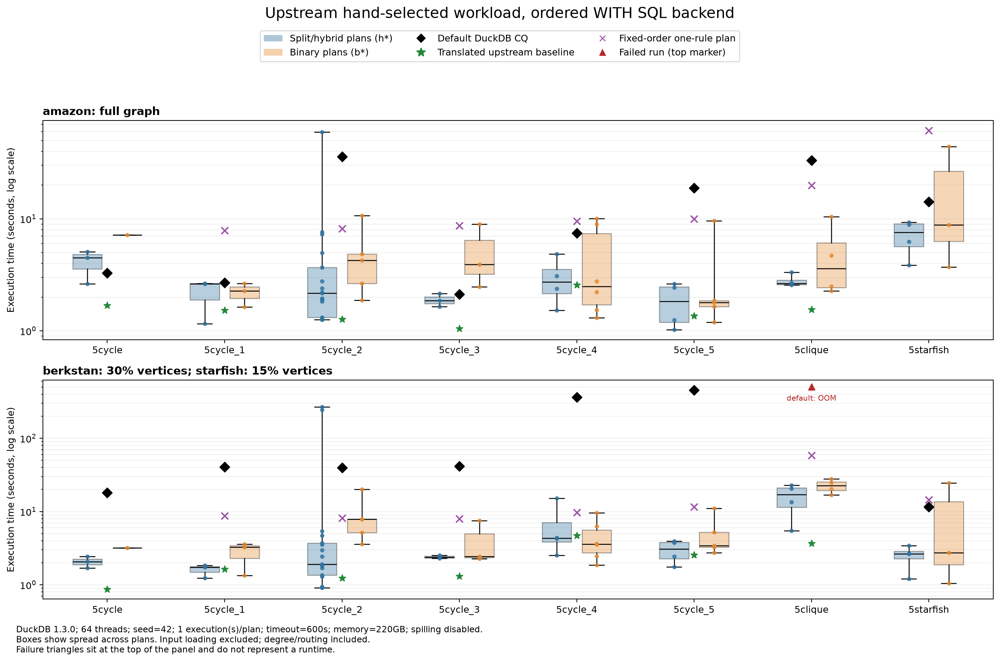

# 上游 hand-selected workload 的 SQL 复现

配置直接来自 `Partitioned-Join-Flowlog` revision `859f71273504f72e3f4cfd730f1067d725b9ce93` 的 [robustness_config_hand.toml](upstream_config_hand.toml)。执行的是本项目的 ordered WITH SQL backend；历史 FlowLog 结果用于独立核对计数，并在 [historical_counts.tsv](historical_counts.tsv) 单独标注。

## 设置与输入

| 输入 | 上游 scale 的含义 | 实际边数 |
|---|---|---:|
| Amazon | 完整图 | 3,387,388 |
| BerkStan | 采样 30% 节点后取 induced subgraph | 690,966 |
| BerkStan，starfish | 采样 15% 节点后取 induced subgraph | 170,834 |

三组输入均为无重复的有向边集。BerkStan 使用上游原版 Rust `scale-edges` 与其锁定依赖，seed=42；没有改为边采样、文件前缀或无向图。输入 CSV、DuckDB cache 和 provenance JSON 在 `/data/wcoj_by_sql/flowlog_sql/`。

按上游设置使用 64 workers、repeat=1、每 plan 600 秒 timeout。SQL 设置为 DuckDB 1.3.0、220GB memory limit、禁用 spilling；禁用 `join_order` 与 `build_side_probe_side`，按给定 rule body 固定 join 顺序。默认 DuckDB CQ 对照保留默认 optimizer。机器是 AMD EPYC 7543，128 logical CPUs；完整信息在 [environment.json](environment.json)。

计时包含 SQL parse、SET/RESET、输入去重、degree preprocessing、routing、中间 join 和最终 COUNT；排除输入加载、connection startup 和 SQL 生成。每次使用新的 read-only connection，串行执行，没有 warmup。每 plan 一次执行，因此箱线图展示的是**不同 plans 的分布**，不是重复实验的置信区间。接近的单次耗时不足以证明稳定优胜。

## 测试矩阵

| Query family | 每组数据的项数，含默认 DuckDB CQ |
|---|---:|
| 5cycle | 6 |
| 5cycle_1 | 9 |
| 5cycle_2 | 25 |
| 5cycle_3 | 9 |
| 5cycle_4 | 13 |
| 5cycle_5 | 12 |
| 5clique | 11 |
| 5starfish | 9 |

上游配置的 86 个 rule programs，加上 8 个默认 DuckDB CQ，每项都在两组数据上运行，完整矩阵为 188 项。

## 文件与复现

- [results.jsonl](results.jsonl)：逐项 timing、count、input provenance、SQL/source hashes、失败信息与历史结果。
- [summary.tsv](summary.tsv) 和 [summary.json](summary.json)：每类查询的默认 DuckDB、上游 baseline、最快 split/binary plan。
- [runtime_spread.png](runtime_spread.png) 和 [PDF](runtime_spread.pdf)：计划分布图。
- [sql/](sql/)：本次实际执行的 SQL。
- [run_metadata.json](run_metadata.json)：配置、revision、计时口径与设置。
- [historical_counts.tsv](historical_counts.tsv)：上游已保存的 FlowLog 计数与历史时间。历史机器、软件与内部计时不同，不可用来声称同机加速比。

输入准备与采样器构建命令见 [上级 README](../README.md#上游同款-workload)。继续已存在的相同配置实验，以及重新汇总：

```bash
.venv/bin/python -m test_5cycle.upstream_benchmark --resume
.venv/bin/python -m test_5cycle.plot_upstream
```

## 本轮结果

完整 188 项矩阵：**187 项成功、1 项 OOM、0 项 timeout**。172 次改写 rule 执行全部成功，计数全部匹配上游保存的 FlowLog 结果；其中 162 次也与本轮直接执行的原始 CQ 一致。BerkStan clique 的 10 个改写 plans 因默认 CQ OOM，使用历史计数校验，原始记录保留 `correctness_match=null` 和 `historical_count_matches=true`。

唯一 OOM 是 BerkStan clique 的默认 DuckDB CQ：约 118.19 秒时触发 220GB memory limit（204.8 GiB），没有完整计数。它在图中标在面板顶部，位置不表示耗时。

下表单位为秒；binary/base 列取本轮手选 binary plans 与上游 baseline 改写版的最小值，范围限于配置内 plans。

| Dataset | Query | 默认 DuckDB | 最快 split/hybrid | 最快 binary/base |
|---|---|---:|---:|---:|
| amazon | 5cycle | 3.292 | h3 / 2.637 | base / 1.683 |
| amazon | 5cycle_1 | 2.686 | h3 / 1.162 | base / 1.523 |
| amazon | 5cycle_2 | 35.921 | h9r / 1.262 | base / 1.271 |
| amazon | 5cycle_3 | 2.124 | h3 / 1.652 | base / 1.051 |
| amazon | 5cycle_4 | 7.445 | h2 / 1.521 | b5 / 1.312 |
| amazon | 5cycle_5 | 18.916 | h4 / 1.025 | b5 / 1.193 |
| amazon | 5clique | 33.295 | h4 / 2.570 | base / 1.553 |
| amazon | 5starfish | 14.256 | h1 / 3.863 | b3 / 3.710 |
| berkstan | 5cycle | 18.144 | h3 / 1.688 | base / 0.872 |
| berkstan | 5cycle_1 | 40.675 | h3 / 1.240 | b3 / 1.344 |
| berkstan | 5cycle_2 | 39.628 | h9 / 0.913 | base / 1.235 |
| berkstan | 5cycle_3 | 41.437 | h2 / 2.296 | base / 1.313 |
| berkstan | 5cycle_4 | 361.853 | h2 / 2.516 | b5 / 1.855 |
| berkstan | 5cycle_5 | 454.542 | h4 / 1.750 | base / 2.549 |
| berkstan | 5clique | MEMORY_OUT | h4 / 5.443 | base / 3.657 |
| berkstan | 5starfish | 11.571 | h1 / 1.200 | b3 / 1.050 |



本轮所有可完成的默认 CQ 都有更快的手选 hybrid，但手选 binary/base 仍在许多 case 更快。五环、`5cycle_3` 和 clique 的上游 baseline 就是明确例子；不要把相对默认 optimizer 的收益全部解释为 split 的收益。每项仅一次执行，接近的数值不能说明稳定优胜。

`5cycle_2` 的 projection variant 也依赖数据：Amazon 的 `9r/9rr` 为 1.262/1.310 秒，BerkStan 为 1.294/0.919 秒。BerkStan 同一 CQ 的 `h6` 和 `h-old` 分别为 243.224 和 266.817 秒，最快 `h9` 为 0.913 秒。

下一步可优先验证共享 wedge/path 的物化成本和显式 join 顺序；仅按 producer 引用次数决定物化仍可能保留代价很高的中间关系。这是基于本轮数据的优化方向，不是已经验证的修复。

完整配置、输入与所有执行 SQL/source hashes 的检查结果在 [audit.json](audit.json)。新一轮完整计时请使用新的 `--output` 目录，`--resume` 仅跳过已有记录。
